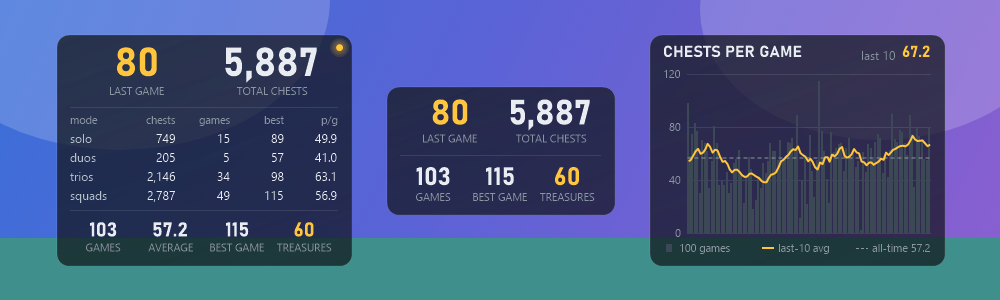
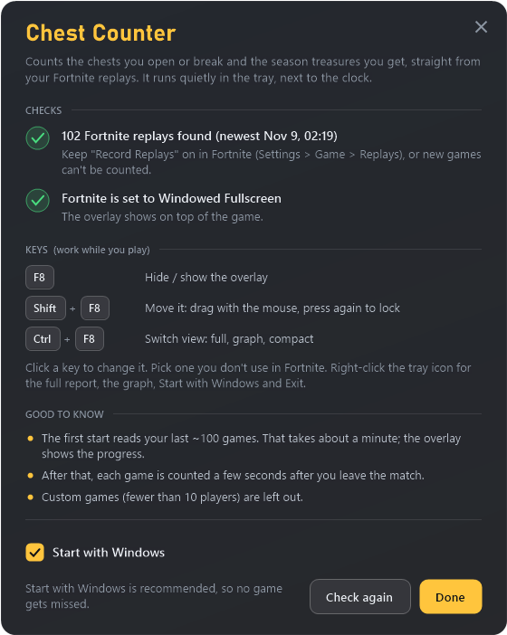

# Fortnite Chest Counter

A small see-through overlay that counts the chests you open or break in Fortnite, straight from your replay files. It also counts the season treasures (gizmos and awards) that came out of your chests.

It sits in the tray and updates a few seconds after each game ends.

*The three views, switched with Ctrl+F8: full (the gold dot means you're in a game), compact, and chests per game. Only the background is see-through; the numbers stay solid.*

## Download

Get **ChestCounter-win-x64.zip** from [Releases](https://github.com/oneboyler/fortnite-chest-counter/releases/latest), unzip it anywhere (not in Program Files) and run **Chest Counter.exe**. There's nothing to install.

Windows may say "Windows protected your PC" the first time, because the app isn't signed. Click **More info > Run anyway**.

On the first start, a setup window checks two things and explains the keys:
- **Replays:** Fortnite must record them. In Fortnite, turn this on under Settings > Game > Replays (Record Replays).
- **Window mode:** Fortnite needs Windowed Fullscreen. The overlay can't show over real Fullscreen.

## Keys

| Key | What it does |
| --- | --- |
| F8 | Hide / show the overlay |
| Shift+F8 | Move it: drag it with the mouse, then Shift+F8 again to lock it |
| Ctrl+F8 | Switch view: full, a graph of chests per game, or compact (just the main numbers) |

To use other keys, right-click the tray icon > **Change keys**, click a key and press the new one. Any key or a mouse side button works, with or without Ctrl/Shift/Alt.

Right-click the tray icon for the full report, Start with Windows, and more.

## What it counts

- **Which chests:** normal chests, rare chests, relic chests, buried treasure and booty chests. Not ammo boxes, supply drops or loot cannons.
- **Opened chests:** exact. The replay records who opened every chest.
- **Destroyed chests:** worked out from rockets, hits, or whoever was standing closest.
- **Season treasure:** every prize gives your character a hidden "prize handler" in the replay.
  - Prizes that line up with one of your own chests count as yours.
  - Teammates' finds (a squad shares prizes) are listed separately in the full report.
  - The replay doesn't say which prize it was. Awards other than gizmos drop once each, so nearly all are gizmos.
- **Which games:** normal Battle Royale (build and zero build) and Ranked, from the current season only. Custom games, Reload, Blitz, LTMs, Creative and older seasons are left out (the full report lists them).

## Updates

From v1.3 on, the app tells you when a new version is out. Right-click the tray icon > **Update**: it downloads the new version, swaps the program files and restarts. Your counted games are kept. (Coming from v1.0–v1.2, download v1.3 once by hand and replace the files.)

## Privacy

Everything stays on your PC. The app reads your Fortnite replays and keeps its counts in a `data` folder next to it.

It only goes online to see if there's a new version on GitHub. You can turn that off in the tray menu.

## Building

You need the .NET 9 SDK. `build.bat` builds a version that uses the installed .NET runtime. `release.bat` builds the self-contained zip.

The replay parsing is a modified copy of [Shiqan/FortniteReplayDecompressor](https://github.com/Shiqan/FortniteReplayDecompressor) (MIT, see `vendor/FortniteReplayDecompressor/LICENSE`).
